# Visitor Registration System — Project Planning Document

Status: Draft for planning review. Flow and journey only. No implementation yet.

This document is the planning baseline for the Visitor Registration System (VRS). It records the two registration channels, the conference-room tea order, the boundary between the public site and the internal portal, and the decisions that must be agreed before solution structure and a repository.

| Item | Content |
| --- | --- |
| System | Visitor Registration System (VRS) |
| Channels in this baseline | Guest pre-registration. Vendor registration at reception. Conference-room tea ordering. |
| Planning gate | Agree the boundary, the channels, and the open decisions in the last section. |
| After this gate | Solution structure, then a repository. |

## 1. Planning objective

Reception needs a record of who is coming, and a controlled way to print a visitor label. The public form is how that record starts. The internal portal is where a staff member checks the person and decides to print.

Two arrival situations are in scope:

- A guest may be sent a static QR before the visit. The success screen says the form succeeded and does not show a reference number. The same guest QR is also on show at reception, next to the vendor QR. If reception cannot match the person to a saved visit, the guest registers on site the same way a vendor does. Reception does not turn the person away.
- A vendor, such as an air-conditioning technician or another worker coming to fix the property, has no QR in advance. Reception shows a static QR at the desk. The vendor submits what they can, and name, company, or the work may be missing. Reception fills those key details, confirms the person, and then chooses whether to print.

A third service uses the same public-site boundary. Each conference room has its own QR. Scanning it opens a tea order page for that room. The order is emailed to reception, and reception contacts the pantry themselves. Nobody confirms the order in the system afterward. Admin staff get an internal report of which rooms and which drinks are used.

Submitting a visitor form does not admit anyone and does not print a label. Submitting a tea order does not track delivery.

## 2. Scope

| In this baseline | Later |
| --- | --- |
| Guest registration from a pre-sent static QR | Other visitors who are not vendors |
| Vendor registration from a QR shown at reception | Deliveries and interview candidates |
| One internal arrival list for both channels | Host approval before print |
| Manual identity check, confirm, and print | Visitor self-service status or edit |
| Staff correction of vendor answers, stored internally | Email or SMS to the visitor |
| Conference-room tea order, email to reception, and an admin usage report | A pantry system, or a step that confirms the tea was delivered |
| | Work-order or asset lookup |
| | Multi-site administration, account provisioning, and technology choices |

## 3. The two channels

| Topic | Guest | Vendor |
| --- | --- | --- |
| When they register | Before the visit | At reception, on arrival |
| How they get the QR | Sent in advance, and the same code is on show at reception | On show at reception, beside the guest code |
| Form address | `/register/guest` | `/register/vendor` |
| How complete the form is | The guest is expected to finish it | Key details may be missing. Reception fills name, company, and work, then chooses Print. |
| Host name | Typed by the visitor | Often unknown. Staff can add it. |
| Visit date | Chosen on the form | Today. The person is already at the desk. |
| How fast the record must appear | Within a few minutes | Within a few seconds. The person is waiting. |
| Staff edit of the answers | Not in this channel | Yes, before the label is printed |
| Confirm, then print | Yes | Yes |

Both visitor channels use a static QR with no person identifier in the code, a create-only public form, an internal pull from the DMZ, and a human decision at the desk before any label is printed. Tea ordering is specified in section 11. It uses the same pull, and it does not confirm or print.

## 4. Planning assumptions

These are the working choices. Each one that still has an alternative is listed again under Open decisions.

1. One static QR per site for guests. It is sent before the visit and also shown at reception. One different static QR per site for vendors, shown at reception beside the guest code. One static QR per conference room for tea. None of these codes identifies a person, and none of them opens a report. The success screen does not show a reference number.
2. One submission is one expected visitor. A second person submits again, or reception deals with them as a separate case later.
3. The public forms do not offer a staff directory, a floor list, or an asset list. The visitor types free text. Publishing those lists would place internal information in the DMZ. The tea page is the exception for a drink menu only: the menu is copied outward, and a room QR shows that room's name, not a list of other rooms.
4. There is no host-approval step. Reception confirms identity and decides to print.
5. Confirm and print are separate actions. Saving a vendor correction does not confirm the person and does not print.
6. The internal network pulls new submissions from the DMZ. The DMZ never opens a connection inward. Vendor corrections are not written back to the DMZ.
7. If a vendor cannot use a phone, reception submits the same public form for them. Visits are still created through that one path.
8. A vendor may submit with name, company, or work left blank. Reception fills those key details on the internal record. Print stays disabled until the visit is Confirmed and all three are filled.
9. Reception works from one arrival list. Rows are marked by channel.
10. Guest ingest is expected within a few minutes. Vendor ingest and tea-order ingest are expected within a few seconds. All three are pulls.
11. A tea order is stored internally, then emailed to reception. The usage report counts that stored order. There is no delivered status.

## 5. Actors

| Actor | Role |
| --- | --- |
| Guest | Fills the public form before arrival. Brings identification that reception can check. |
| Vendor | Arrives without a code, scans the desk QR, and submits what they can. Shows identification. |
| Person in a conference room | Scans that room's tea QR and chooses drinks. |
| Reception staff | Signs in to the internal portal, finds the record, confirms the person, and may print a label. For a vendor, shows the QR, fills in any missing name, company, or work, and then selects Print. May submit the public form when the vendor cannot. For tea, reads the order email and contacts the pantry manually. |
| Admin staff | Reads the internal tea usage report. Does not receive the order email as part of this baseline. |
| Pantry | Prepares the order after reception contacts them. Not a system user. |
| Host | The internal person the visitor came to see, or the area that needs the work. Named in free text. Not a system user in this baseline. |
| Ingest job | Copies new submissions into the VRS and tells the DMZ it may delete them. |
| Printer | Internal device. Receives a label job only after a staff member chooses Print. |

## 6. Solution boundary

A compromised or curious public site must not be able to read the visitor register, staff accounts, the property asset list, past visits, or badge history. The DMZ holds only what a visitor just typed, and only until the internal system has taken a copy.

Staff corrections are stored in the internal database. The public site never receives the corrected version.

### Registration channels and the internal portal

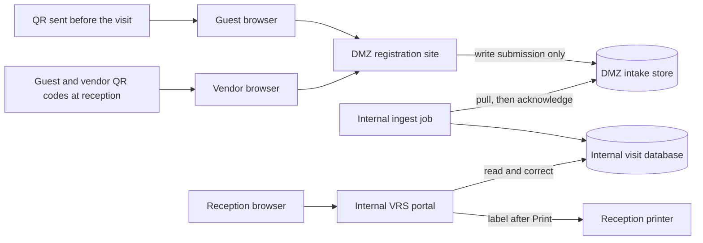

| From | To | Allowed | Why |
| --- | --- | --- | --- |
| Internet, including a phone at the desk or in a conference room | DMZ forms (HTTPS) | Yes | Visitors and tea orders must open the page. |
| DMZ | Internal network | No | A forwarded or photographed QR must not become a path into the VRS. |
| Internal ingest | DMZ intake, read and acknowledge only | Yes | The internal side initiates the copy. That account cannot read the internal database. |
| Reception workstations | Internal VRS | Yes | Corrections, confirm, and print stay on the corporate network. |
| Internal VRS | Reception printer | Yes | The print path never leaves the internal network. |
| Internal VRS | DMZ, menu catalog only | Yes | The drink list is published outward so the tea page can show it. Orders and the usage report are not included. |
| Internal VRS | Reception mailbox | Yes | One plain-text email per stored tea order. |
| Internal VRS | DMZ intake or visitor data | No | Corrected names, hosts, work text, orders, and reports are not pushed back out. |
| DMZ | Internal printer or reception mailbox | No | A public submission must not print a badge or send the reception email. |

After a successful copy, ingest acknowledges the row and the DMZ deletes the payload. It may keep a hash for a short time so an exact replay can be rejected. It does not keep the name, phone, email, host, or work description after acknowledge. The person is not given a number for that replay check.

The success screen shows only that the submission succeeded. It does not show a reference number, and the system does not send one. Reception looks up the visit by name, company, and date. An internal visit id may exist for the record. It is not shown to the person and it is not a badge.

## 7. What each zone holds

| Data | DMZ | Internal VRS |
| --- | --- | --- |
| The answers just submitted | Yes, until acknowledge | Yes, after ingest |
| Staff corrections after ingest | No | Yes |
| Other visitors' records | No | Yes |
| Staff directory, floor list, asset list, passwords | No | Yes. They are not copied out to the form. |
| Confirm, print, and decline status | No | Yes |
| Who edited, who confirmed, who printed, and when | No | Yes |
| Label content and printer status | No | Yes |
| Internal visit id | No | Yes |
| Tea orders and the usage totals | The order just placed, until acknowledge | Yes, including room and drink totals |
| Drink menu | Yes. This is the catalog the page displays. | Yes. Admin maintains it here, then it is copied outward. |

The public success page shows only that the submission succeeded. It does not show a reference number. It does not say whether the host exists, whether this person already has a record, or whether a label will be printed. It has no link to update the submission. The tea page says the request was sent. It does not offer a status check, a history of orders for the room, or a way to cancel.

## 8. Rules for both visitor channels

Tea orders do not use the visit states below. They are recorded in section 11.

- The QR encodes the channel URL and nothing else. No staff id, no API key, no visit id, no asset id.
- The DMZ API accepts create-submission only. It has no endpoint that lists, gets, updates, or deletes a visit.
- Errors are generic. They do not reveal whether a similar submission exists.
- Text is stored and shown as plain text. The portal and the label template must not treat it as HTML or as printer commands.
- A second submission for the same person creates a second expected visit. Reception dismisses the duplicate. The system does not merge on name.
- Identity is a manual check against photo identification. The system does not decide identity.
- Print stays disabled until the visit is Confirmed. Reception may confirm and still withhold a label, for example when the host will escort the visitor.
- Every confirm, decline, dismiss, save, print, and reprint writes an audit row: staff id, action, time, and visit id. Audit rows are internal only.
- Named staff accounts are used. A shared desk login would hide who confirmed and who printed.

### Visit states

States live only in the internal VRS. The DMZ lifecycle is received, then deleted after acknowledge. Correcting a vendor record does not by itself change the state. Guest records do not use the correction loops.

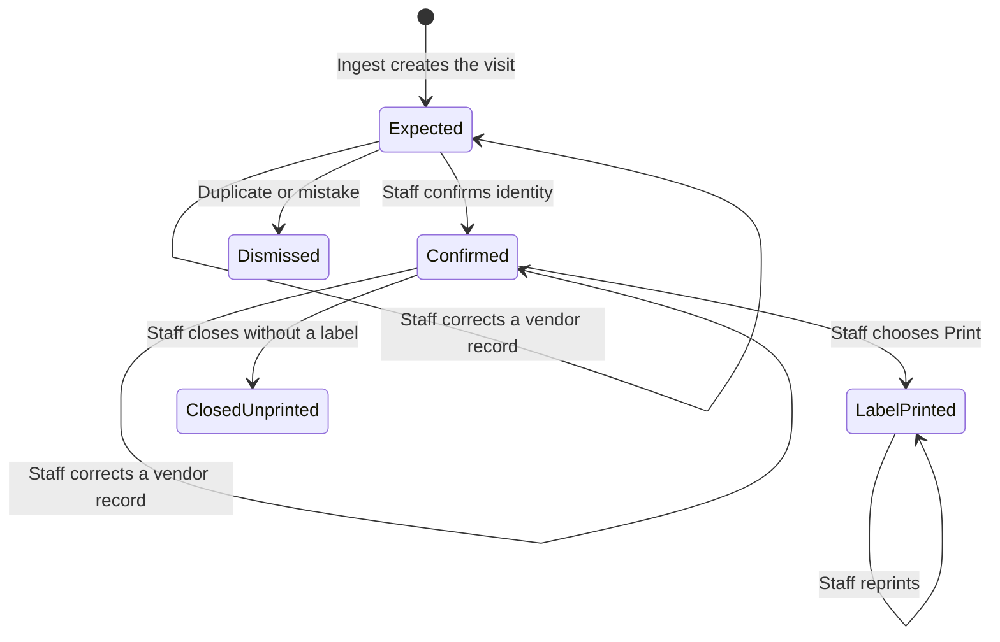

| State | Meaning | Label |
| --- | --- | --- |
| Expected | Copied from the form. The person has not been confirmed. Vendor answers may still be incomplete. | No |
| Confirmed | Staff accepts this person for this visit. | Not yet |
| LabelPrinted | At least one label job was sent, using the saved answers. | Yes |
| Dismissed | A duplicate or test row. This is not a decision to turn a person away. | No |
| ClosedUnprinted | Visit accepted and finished without a badge. | No |

A correction after printing does not change a label already handed over. A new label requires Reprint, and that action is audited.

## 9. Guest channel

A guest may receive the static QR and the same URL in text before the visit. The same QR is on show at reception beside the vendor QR. Illustrative address: `https://visit.example.com/register/guest`. Possession of the QR is not permission to enter. If reception cannot match the person to a saved visit, the guest uses that reception QR and registers on site, with the same missing-detail and print steps as a vendor.

### Before the visit

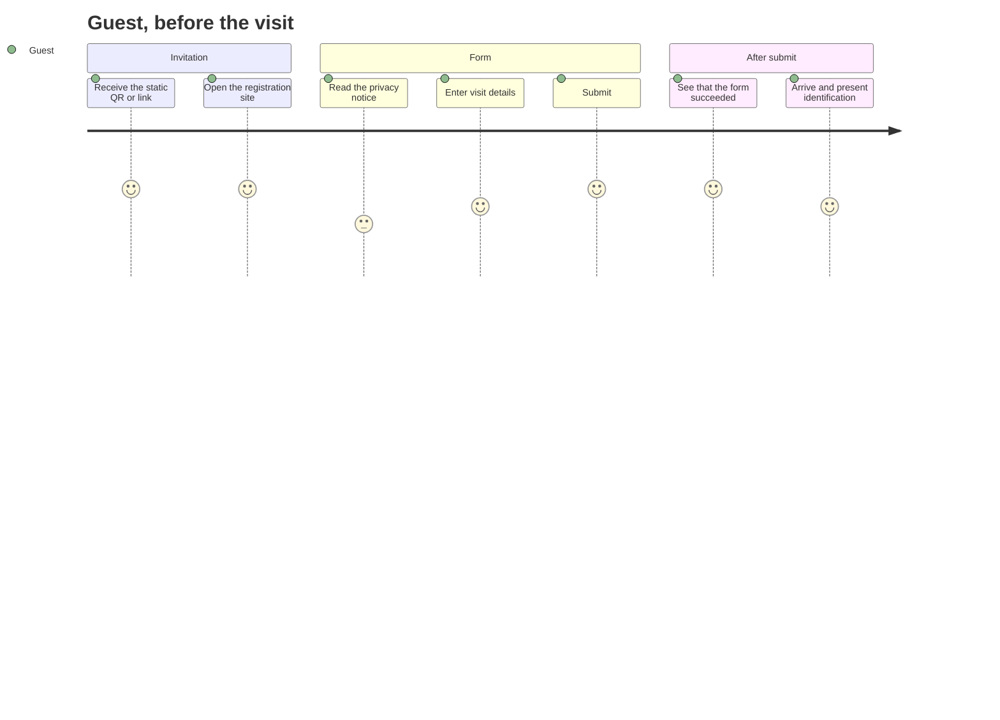

| Step | What the guest does | What the system does | What the guest does not get |
| --- | --- | --- | --- |
| 1 | Receives the QR or URL before the visit | Nothing yet. The code is static and already printed. | A personal account, a unique pass, or a pre-printed badge |
| 2 | Opens the link | Shows the guest form over HTTPS | Any list of visits, hosts, or previous submissions |
| 3 | Completes the form and accepts the privacy notice | Validates fields in the browser and again on the DMZ | A staff dropdown |
| 4 | Submits | Writes one intake row. The screen says the form succeeded. No reference number is shown or sent. | Confirmation that the host is real, or that entry is approved |
| 5 | Comes to reception | Internal ingest copies the row, then the DMZ deletes the payload | A badge, a reference number, or a status page to poll |

The guest can submit and travel immediately. Reception sees the visit only after ingest. Same-day use of this QR is possible, and staff may need to wait for the copy. They look up the person by name. If no visit matches, the guest registers on site with the guest QR at the desk.

### At reception

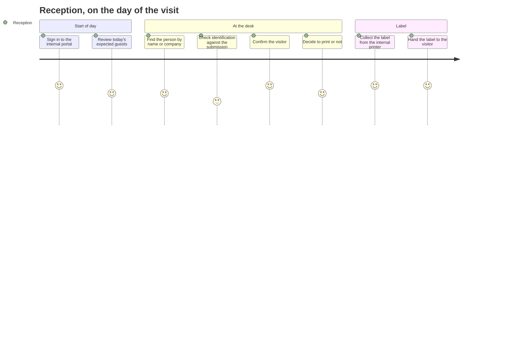

| Step | Staff action | Result |
| --- | --- | --- |
| 1 | Sign in on the internal portal | Session on the corporate network only |
| 2 | Open today's arrival list | Sees ingested guest rows for the site and date. Rows still only in the DMZ are not shown. |
| 3 | Match the person at the desk | Search by name, company, and visit date. There is no reference number to ask for. |
| 4 | Compare photo identification with the name and company | Manual check |
| 5 | Confirm arrival | Status becomes Confirmed. No print yet. |
| 6 | Choose Print, or leave it unprinted | Print sends one job to the reception printer |
| 7 | If no saved visit matches the person | The guest scans the guest QR at reception and registers on site, like a vendor. Reception fills any missing key details, then selects Print. |

### End-to-end

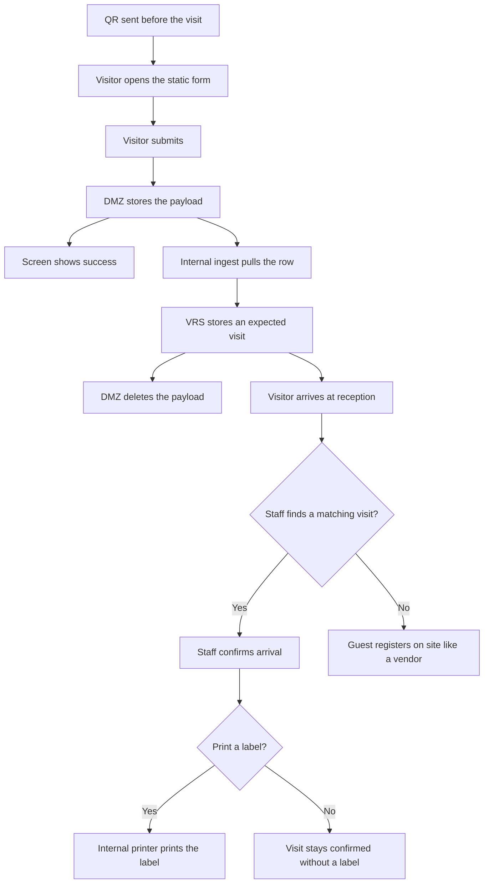

### Sequence

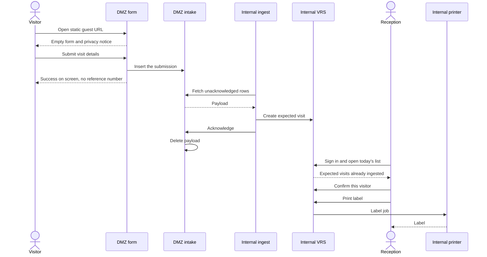

### Registration form

| Field | Required | Notes |
| --- | --- | --- |
| Full name | Yes | As on the identification they will show |
| Company | Yes | Guest organisation |
| Role | Yes | Guest. The static page may fix this instead of asking. |
| Purpose of visit | Yes | Short text. Not printed on the label. |
| Host name | Yes | Free text. Not looked up against the staff directory. |
| Visit date | Yes | Not in the past beyond the same day. Upper bound to be agreed, for example 30 days. |
| Mobile number | Yes | Used if reception must call. Not printed. |
| Email | Yes | Kept for a later optional notice. Not required for printing. |
| Privacy notice acknowledgement | Yes | States who receives the data, and that the public site does not show other visitors. |

No file upload. No national-id number. Reception looks at the physical identification and does not type the id number unless a later policy requires it.

Field length limits, a bot check, and a rate limit sit on the DMZ. They do not consult the internal database.

## 10. Vendor channel

A vendor comes to fix or service the property. They are not sent a QR beforehand. Reception shows one static QR on a screen or on a fixed card. Illustrative address: `https://visit.example.com/register/vendor`. The visit date is set by the server to today in the site timezone. This form does not offer a future date.

### At the desk

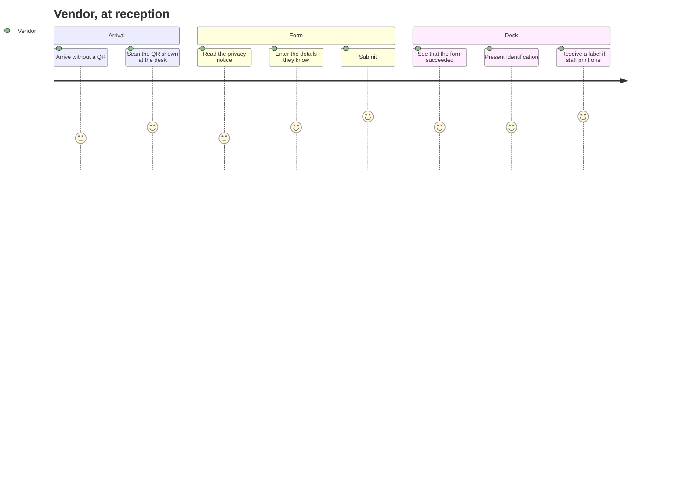

| Step | What the vendor does | What the system does | What the vendor does not get |
| --- | --- | --- | --- |
| 1 | Arrives and asks for entry | Nothing until a form is submitted | A badge based on a prior email |
| 2 | Scans the QR, or types the URL shown beside it | Shows the vendor form over HTTPS | A staff list, a floor list, or yesterday's visits |
| 3 | Enters what they know. Name, company, and work may be left blank. | Accepts the submission when the privacy notice is checked | A demand to finish every key field on the phone |
| 4 | Submits | Writes one intake row. The screen says it succeeded. No reference number is shown or sent. | A way to edit the form afterwards |
| 5 | Waits while reception fills any missing key details and checks identification | Internal ingest copies the row, then the DMZ deletes the payload | A label from the phone |

If the first submission looks wrong, the vendor tells reception. Reception edits the internal copy. A second submission is dismissed rather than merged.

### Reception

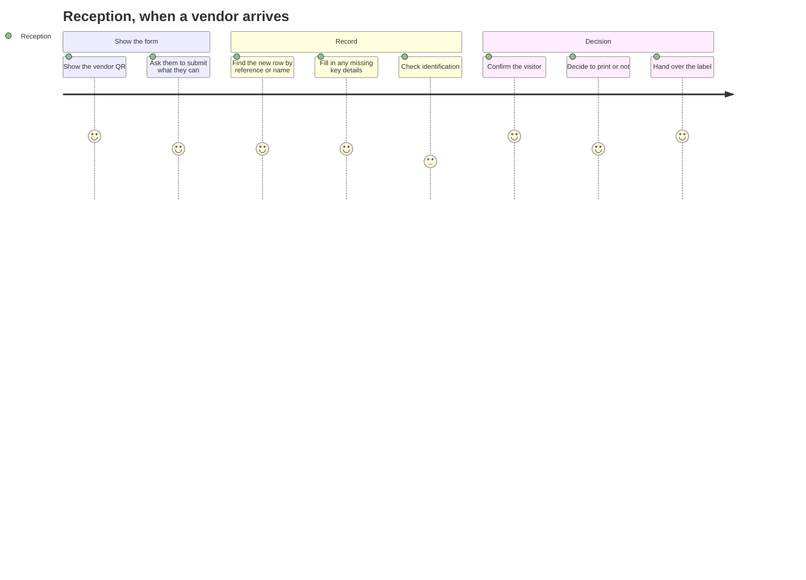

| Step | Staff action | Result |
| --- | --- | --- |
| 1 | Show the vendor QR | The visitor uses their own phone. If they cannot, staff submit the same public form for them. |
| 2 | Open the new vendor row | Search by name, or open the latest row for today. There is no reference number to ask for. |
| 3 | Fill in the missing key details | Name, company, and work can be entered or corrected here. Host, location, and a long work description can be changed too. Save writes an audit row. Print is not sent by this save. |
| 4 | Compare photo identification with the name on the record | Manual check |
| 5 | Confirm arrival | Status becomes Confirmed. No print yet. |
| 6 | Choose Print, or leave it unprinted | Print sends one job |
| 7 | If this is a duplicate row | Dismiss it. The person at the desk is not turned away. |

The vendor can be looking at the success page while ingest runs. If the row is not visible yet, staff wait for the next pull and look for the newest row under that name. They do not retype the visit into a second system.

### End-to-end

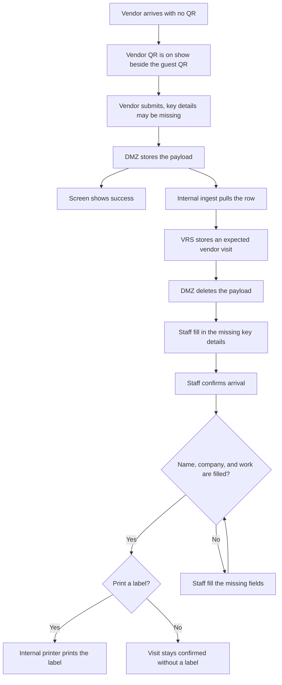

### Sequence

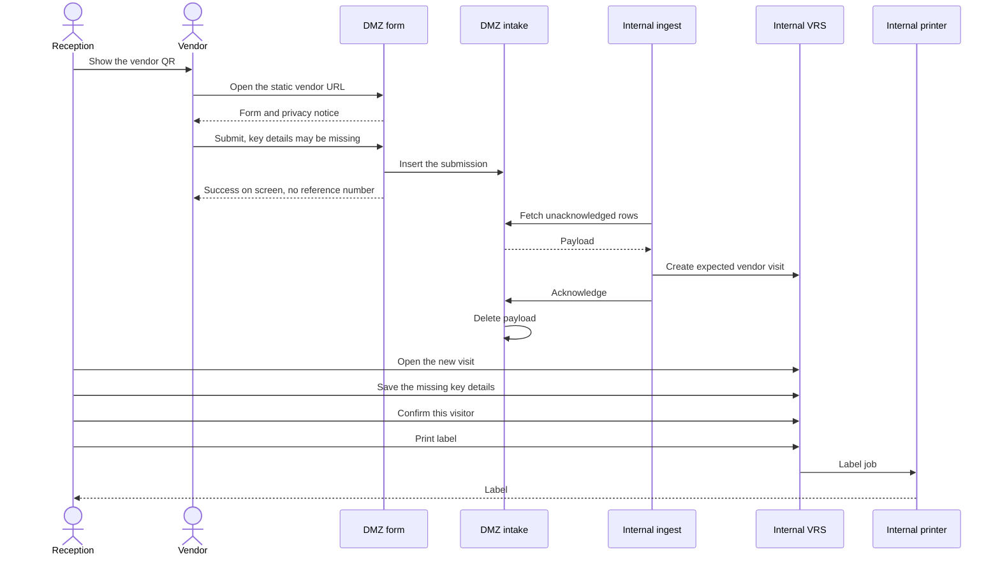

There is no arrow from the VRS back to the form or the intake store.

### Registration form

| Field | Required to submit | Notes |
| --- | --- | --- |
| Full name | No | Key detail. May be missing on submit. Reception fills it before Print. |
| Work to be done | No | Key detail. For example air-conditioning repair. May be missing on submit. Reception fills or shortens it before Print. |
| Company | No | Key detail. Employer or trading name. May be missing on submit. Reception fills it before Print. |
| Location or area | No | Free text, such as a floor or room. Not chosen from an internal asset list. |
| Host name | No | Free text, only if the vendor knows who called them. |
| Mobile number | No | Used if reception must call. Not printed. |
| Privacy notice acknowledgement | Yes | States that reception will see the answers and may correct them. |

### Corrections

Reception fills the key details on the internal visit. The vendor cannot add them after submit, and the DMZ payload may already have been deleted. Name, company, and work are the key details. Print stays off until all three are saved and the visit is Confirmed. Reception then selects Print.

| Answer | Staff can change it | Required before Print |
| --- | --- | --- |
| Full name | Yes | Yes |
| Work to be done | Yes | Yes |
| Company | Yes | Yes |
| Location or area | Yes | No |
| Host name | Yes | No |
| Mobile number | Yes | No |

The work line on the label is the saved work text. The original submitted wording remains in the audit. Each save stores the staff id, the time, and the fields that changed.

Anyone can photograph the reception QR and submit later from somewhere else. That row appears as an expected vendor for today. Staff print a label only for the person at the desk, after checking identification. Unused rows are dismissed.

## 11. Conference room tea service

Each conference room has its own static QR. Scanning it opens a tea order page for that room only. The person chooses drinks from a fixed menu and submits. Reception receives one email and contacts the pantry manually. The system does not ask anyone to confirm that the tea arrived.

The order still enters through the DMZ and is pulled inward. The email is sent from the internal side after the order is stored, so the public site cannot mail reception and cannot read which rooms or drinks are popular.

Illustrative address, fixed on the card in that room: `https://visit.example.com/tea/board-room-a`

### Ordering

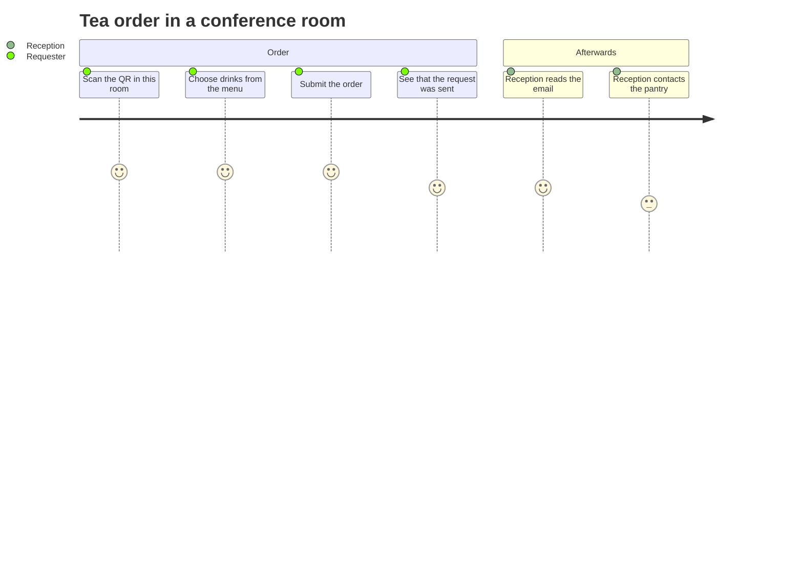

| Step | What happens | What the person does not get |
| --- | --- | --- |
| 1 | The page shows this room's name and the drink menu | A list of other rooms, or a way to switch room |
| 2 | They select one or more drinks and a quantity for each | A free-text drink name that would break the usage totals |
| 3 | They may add a name and a short note | A login |
| 4 | Submit stores one order in the DMZ intake and shows "Request sent" | An order history, a status page, or an email of their own |
| 5 | Ingest copies the order, the DMZ deletes the payload, and the VRS emails reception | A confirmation step |
| 6 | Reception contacts the pantry by phone or in person | A pantry account in the VRS |

### End-to-end

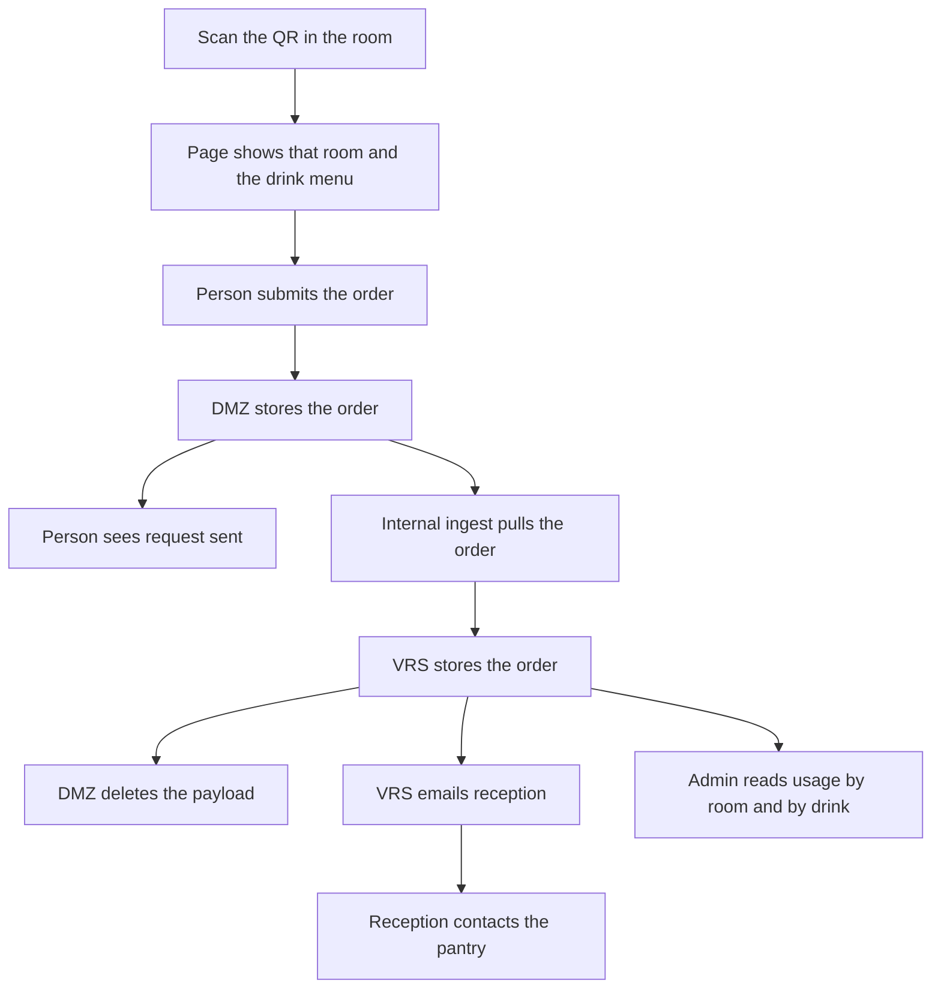

The report counts the stored order. It does not wait for the pantry, and it does not change if reception never replies to the email.

### Sequence

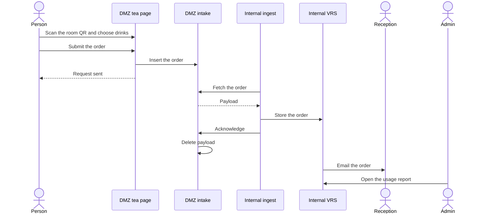

Reception's contact with the pantry is outside this sequence.

### Order page

| Field | Required | Notes |
| --- | --- | --- |
| Room | Fixed by the QR | Shown on the page so the person can see the room. Not chosen from a directory. |
| Drinks and quantities | Yes, at least one | Chosen from the menu. This is what the popularity report counts. |
| Name | No | Included in the reception email when provided. Left out of the popularity totals. |
| Note | No | Short plain text in the email. Not treated as a drink name. |

Admin maintains the drink list in the internal portal. A one-way copy publishes the current list to the tea page. That copy does not include past orders.

The create-only rules in section 8 apply. The tea URL has no endpoint that lists orders or returns totals.

### Email to reception

Sent only after the internal record is stored. If sending fails, the order remains stored and the send is retried. The message is plain text from a fixed template:

- Room name
- Time of the order
- Each drink and its quantity
- Name, when the person entered one
- Note, when the person entered one

There is no confirm link and no cancel link. Reception uses the email as the notice, then speaks to the pantry.

A photographed QR can be used from outside the room. The working control is a rate limit on that room's URL, on the DMZ, without reading the internal report. Reception still judges whether to call the pantry.

### Usage report

Admin staff open this report in the internal portal. Reception does not need it to fulfil an order. The public site does not show it.

| View | What it answers |
| --- | --- |
| By room | How many orders, and how many items, each room placed in the chosen period |
| By drink | How many of each drink were ordered in the chosen period |
| By day | How orders are spread across the period, so a busy day can be seen |

Filters are the date range, and optionally one room or one drink. Totals are of orders placed. They are not totals of drinks delivered, because this channel has no delivered status.

An order stores the room, the drink lines, the quantities, the time, and the optional name and note. The name and note stay on the order record so the email can be retried. The room view and the drink view do not list names.

## 12. Reception portal

Both channels are handled in one internal portal, which is not published to the internet.

| Screen | Purpose |
| --- | --- |
| Sign in | Staff identity. The account store is internal. |
| Today's arrivals | Guest and vendor rows for the site and date, marked by channel. Newest vendor rows are easy to pick out. |
| Visit detail | Form answers, state, and actions. Vendor fields are editable. A guest who registered at the desk can also be completed by reception. A guest who registered before the visit is shown for checking. |
| Save key details | Vendor records only. Fills in name, company, or work when the submission left them blank. Does not confirm and does not print. |
| Confirm | Records staff id and time. |
| Print | One label. Reception selects this after the key details are saved. For a vendor it stays off until the visit is Confirmed and name, company, and work are filled. The screen names which of those is still missing. |
| Dismiss | Closes a duplicate row. Does not turn the person away. Does not print. |
| Drink menu | Admin maintains the list that is copied to the tea page. |
| Tea usage | Admin report of orders by room, by drink, and by day. |

Session timeout applies at the desk. The printer is not reachable from the DMZ. Tea orders are not confirmed or dismissed on these screens.

## 13. Labels

Printed only after Confirm, and only by the internal print path. A short badge number may be generated inside the VRS at print time. That number is not known to the DMZ.

### Guest

| On the label | Not on the label |
| --- | --- |
| Name | Mobile number |
| Company | Email |
| Guest | Purpose text |
| Visit date | A reference number |
| Host name | Staff accounts or internal ids |
| Site name | Anything from other visits |

### Vendor

| On the label | Not on the label |
| --- | --- |
| Name | Mobile number |
| Company | Location text, unless staff copied a short location into the work line |
| Vendor | A reference number |
| Work to be done, as saved by staff | The long original sentence, if staff shortened it |
| Visit date | Staff accounts or internal ids |
| Host name, when it is filled | Anything from other visits |
| Site name | |

## 14. Security controls

### External site

- TLS only. Each channel page and its submit API are the only public routes.
- No staff login on this hostname. No shared database with the VRS.
- Security headers, no directory listing, and no server version banner.
- Create-only API. No query parameters that select a record.
- Payloads are deleted on acknowledge.
- The form's database account can insert. The ingest account can read unacknowledged rows and mark them acknowledged. Neither account can reach the internal database.

### Boundary

- The firewall default is deny from the DMZ to the internal network.
- Ingest runs on the internal side and dials out to the intake endpoint.
- Acknowledge happens only after the internal database commit succeeds. A failed copy stays for the next pull.
- Vendor and tea polling are more frequent than guest polling. The extra speed does not add a path from the DMZ inward.
- The tea email is sent from the internal side after the order is stored. The template is plain text. A note on the order is inserted as text, not as HTML.
- The usage report is an internal page. The tea QR cannot request it.

### What this baseline still accepts

Either QR can be forwarded or photographed. Anyone can submit a false visit. Entry is not automatic: reception compares the person and the identification, then decides. The form is a notice of intent, not an authorisation.

A submission can contain misleading text. The effect is limited to internal screens, the label template, and the tea email, which treat that text as plain text.

A room QR can be photographed and used to send tea requests. Those requests are still only emails and report rows. Reception decides whether to call the pantry.

## 15. Accessibility requirements for the later UI

The forms, the reception QR, and the portal need to be usable with a keyboard and a screen reader.

- Every input has a visible label, a programmatic name, and a described error. Optional fields are marked optional.
- The privacy acknowledgement is a real checkbox and is not pre-ticked.
- Errors are summarised and focus moves to the first invalid field.
- Save, Confirm, Print, and Dismiss are named buttons.
- When Print is disabled, the reason is text, for example that the visit is not confirmed or that company is still empty.
- Status is text as well as colour.
- Every QR is accompanied by the same URL in text. The reception QR is large enough to scan at the desk. The room card is readable from a seat at the table.
- Each drink is a named choice with a quantity field, not a colour alone.
- The usage report's room and drink totals are text in a table, with a text alternative to any chart added later.

## 16. Out of scope

- Other visitors who were not sent the Guest QR and are not registering as a Vendor at reception
- Deliveries and interview candidates
- Host approval before print
- Visitor self-service edit or status lookup
- Email or SMS to the visitor. The tea-order email to reception is in this baseline.
- A work-order system, and any lookup of equipment from the public form
- Storing the identification number
- Badge artwork, beyond the label contents in this document
- Reprint policy beyond an audited reprint
- Account provisioning and password policy detail
- Repository layout and technology choices

## 17. Open decisions

| Topic | Draft in this baseline | Alternative |
| --- | --- | --- |
| Guest QR | One static code per site for all guests | One static code per company |
| QR codes at reception | Guest and vendor codes are both on show | Staff reveal a code only when someone arrives |
| Host on the guest form | Free-text name, matched by reception | Publish a name-only host list into the DMZ |
| Required on the vendor's phone | Privacy checkbox only. Name, company, and work may be blank. | Also require name before submit |
| Vendor who cannot use a phone | Staff submit the same public form, then edit internally | An internal-only create button |
| Staff edit | Vendor records only | Also allow edit of guest answers |
| Approval | Reception confirms at the desk | Host must approve in the portal before Print is enabled |
| Guest ingest | Within a few minutes | Near-real-time |
| Vendor ingest | Within a few seconds | Near-real-time |
| Arrival list | One list for guests and vendors | A separate screen per channel |
| Work text on the vendor label | Yes, after staff shorten it if needed | Name and company only |
| Location on the vendor label | Not printed by default | Print a short location line |
| How long the internal record is kept | Not set | Agree a retention period before build |
| Identification number | Look at the document, do not store the number | Store it for compliance |
| Accompanying people | Separate submissions | One form can name extra people |
| Tea QR | One static code per conference room | One code for every room, and the person picks the room |
| Name on a tea order | Optional. Used in the email. Omitted from popularity totals. | Required name |
| Tea email | Sent from the internal system after the order is stored | Sent directly by the DMZ page |
| What the report counts | Orders placed | Orders reception marks as served |
| Tea rate limit | Limited repeats on the same room URL | No limit |

## 18. Planning gate

Build does not start from this document until the boundary in section 6, the vendor correction rule in section 10, the print rules in section 8 and section 12, the tea order and usage report in section 11, and the open decisions in section 17 are accepted or changed. The next planning step after that agreement is the solution structure, and then a repository.
