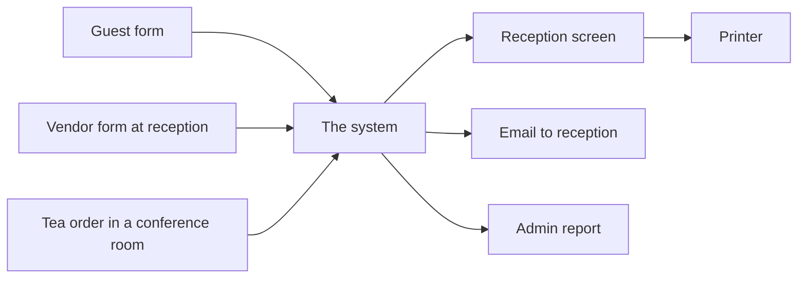
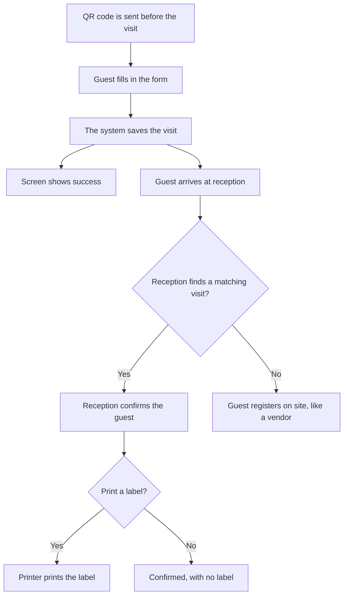
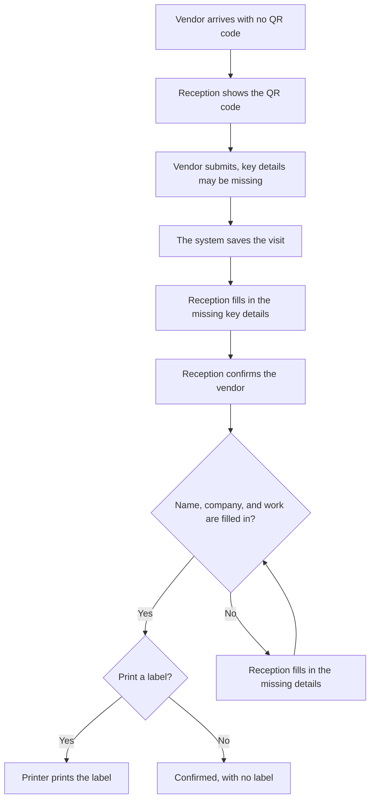
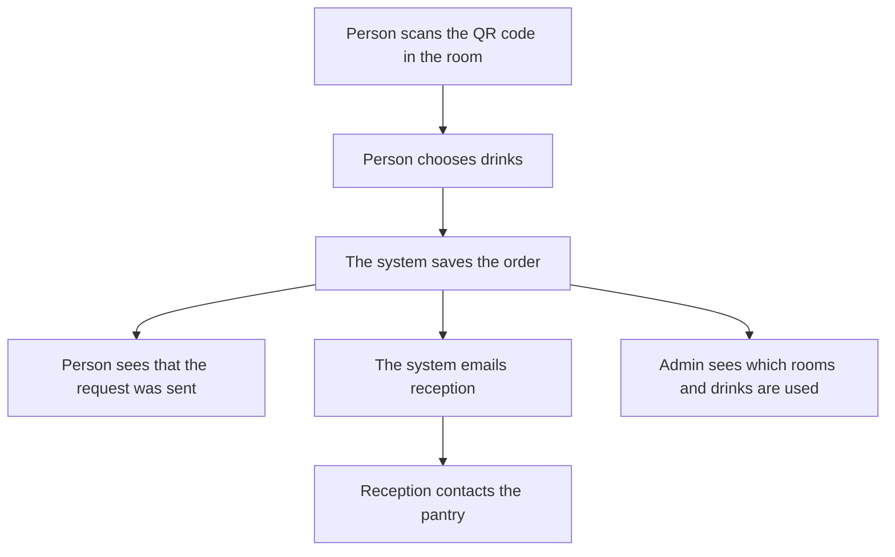

# Visitor Registration System — Staff Planning Document

Status: Draft for staff review. This explains the flows. It is not a build plan.

This document is for reception and admin staff. It uses the same three services as the project planning document, in everyday language. Where that document names separate technical parts, this one says **the system**.

The system does three jobs:

- A guest can fill in a form before the visit. The screen says the form succeeded. It does not show a reference number. If reception cannot match them to that visit, the guest registers at the desk instead. Reception does not turn them away.
- A vendor arrives without a form. Reception shows a QR code. The vendor submits what they can, and key details may be missing. Reception fills those in, checks the person, and then chooses whether to print a label.
- A person in a conference room scans that room's QR code and orders tea. The system emails reception. Reception contacts the pantry. Nobody confirms the order afterwards. Admin staff can see which rooms and drinks are used most.

Filling in a form does not let someone in, and it does not print a label. Ordering tea does not record whether the tea was delivered.

## 1. How the three services meet

| Service | Who starts it | What reception does | What admin sees |
| --- | --- | --- | --- |
| Guest | Before the visit, or at the desk if no visit is found | Finds the visit by name. If none matches, the guest uses the guest QR at the desk, the same way a vendor registers. Then reception may print a label. | The same arrival list as reception |
| Vendor | The visitor, at the desk, using the QR code reception shows | Fills in any missing key details, checks identity, confirms, and then chooses whether to print | The same arrival list as reception |
| Tea | Anyone in that conference room | Reads the email and contacts the pantry | Which rooms and drinks are ordered most |

The form pages only accept what the person types. They do not show other visitors, other orders, or the admin report. Only staff who sign in can see the arrival list, print a label, or open the tea report.

## 2. Guest

One guest QR code is sent before the visit. The same code is also on show at reception, next to the vendor QR code. It does not name the person.

They should bring identification. Reception looks for the saved visit by name and company. The system does not decide who the person is, and it does not turn anyone away.

### Flow

| Step | What people do |
| --- | --- |
| 1 | The guest receives the QR code, or the same link written out, before the visit. The same QR code is also at reception. |
| 2 | They enter name, company, purpose, host name, visit date, mobile, and email, and they accept the privacy notice. The visit type is Guest. |
| 3 | The system saves the visit. The screen says it succeeded. It does not show a reference number, and none is sent. |
| 4 | On the day, reception signs in and looks for the visit by name, company, and date. |
| 5 | If a visit matches, reception confirms the guest. Confirming does not print. |
| 6 | Reception chooses Print, or leaves the visit confirmed with no label, for example when the host will escort them. |
| 7 | If no visit matches, the guest scans the guest QR code at reception and registers on site, using the same steps as a vendor. Reception fills any missing key details, then selects Print. |

A visit sent just before arrival may take a few minutes to appear on the reception screen. Staff look again by name. They do not ask for a reference number.

If the same person submits twice, reception keeps one visit and dismisses the other. The system does not join records because two people can share a name.

### What is on the label

Name, company, Guest, visit date, host name, and site name. Mobile, email, and the purpose are not printed.

## 3. Vendor

A vendor comes to fix something on the property, for example the air conditioning. They are not sent a QR code. Reception has the vendor QR code on show beside the guest QR code. The visit date is today.

### Flow

| Step | What people do |
| --- | --- |
| 1 | Reception shows the vendor QR code, which stays on the desk next to the guest QR code. The same web address is written beside it. |
| 2 | The vendor enters what they know. Name, company, and the work can be left blank. Location, host, and mobile can be left blank too. |
| 3 | The system saves the visit. The screen says it succeeded. It does not show a reference number. The vendor cannot go back and edit the form. |
| 4 | Reception finds the visit and fills in any missing key details: name, company, and the work. They can also correct spelling, host, location, or a long work description. |
| 5 | Reception checks photo identification, then confirms. |
| 6 | Print stays off until the visit is confirmed and name, company, and work are all filled in. |
| 7 | Reception selects Print, or leaves the person confirmed with no label. |

If the vendor cannot use a phone, reception fills in the same form for them, then corrects it on the reception screen if needed.

The new visit should appear within a few seconds. If it is not there yet, reception waits and looks for the newest visit under that name. Reception does not ask for a reference number, and does not type the same visit into a second place.

### What reception can change

| Detail | Reception can change it | Needed before printing |
| --- | --- | --- |
| Full name | Yes | Yes |
| Work to be done | Yes | Yes |
| Company | Yes | Yes |
| Location | Yes | No |
| Host name | Yes | No |
| Mobile | Yes | No |

The work line on the label is the wording reception saved. If the vendor wrote a long sentence, reception shortens it before printing. The system keeps the original wording in the record.

### What is on the label

Name, company, Vendor, the work as saved by reception, visit date, host name if it was filled in, and site name. Mobile is not printed.

## 4. Tea in a conference room

Each conference room has its own QR code. Scanning it opens the tea page for that room only. The person cannot switch to another room. They choose drinks from the menu. Admin looks after that menu.

### Flow

| Step | What people do |
| --- | --- |
| 1 | The person scans the QR code in the room, or types the address printed beside it. |
| 2 | The page shows that room's name and the drink list. They choose at least one drink and a quantity. Name and a short note are optional. |
| 3 | They submit. The page says the request was sent. There is no status page and no email back to them. |
| 4 | The system emails reception with the room, the time, the drinks, and the name or note if they were entered. |
| 5 | Reception contacts the pantry by phone or in person. |
| 6 | Admin can later see how often each room and each drink was ordered. |

There is no button to confirm that the tea arrived, and no button to cancel. The report counts orders placed, not drinks delivered.

The email includes:

- Room name
- Time of the order
- Each drink and how many
- Name, if the person entered one
- Note, if the person entered one

If the email does not go out the first time, the system keeps the order and tries again.

### Usage report

Admin staff open this from the same sign-in as reception. Reception does not need the report to handle an order. People using the room QR code cannot see it.

| View | What it answers |
| --- | --- |
| By room | How many orders each room placed in the period chosen |
| By drink | How many of each drink were ordered |
| By day | Which days were busy |

The room view and the drink view do not list people's names.

## 5. What reception sees after signing in

| Screen | What it is for |
| --- | --- |
| Today's arrivals | Guests and vendors for today. The type is shown on each row. New vendor visits are easy to spot. |
| Visit details | The answers and the buttons. Vendor details, and a guest who registered at the desk, can be corrected. A guest who registered before the visit is shown for checking. |
| Save | Saves the key details reception filled in for a vendor. It does not confirm and does not print. |
| Confirm | Records which staff member accepted the person, and when. |
| Print | Prints one label. For a vendor, this stays off until the visit is confirmed and name, company, and work are filled in. The screen says which of those is still missing. |
| Dismiss | Used for a duplicate row. It is not a way to turn a person away. No label. |

The system records who confirmed, who printed, and who changed a vendor's details.

Someone can photograph a QR code and submit from somewhere else. For a guest or a vendor, reception still checks the person at the desk before printing. For tea, reception still decides whether to call the pantry.

## 6. What is not in this plan yet

- Other visitors who were not sent the Guest QR code and are not registering as a Vendor at reception
- Deliveries and interview candidates
- The host approving the visit before reception prints
- The visitor checking their own status, or changing the form after they submit
- An email or text message to the visitor
- A pantry screen, or a step that marks tea as delivered
- Typing the identification number into the system
- Choosing how long records are kept

## 7. Choices still to agree

| Topic | Working choice | Other option |
| --- | --- | --- |
| Guest QR code | One code for the site, sent before the visit | One code per company |
| QR codes at reception | Guest and vendor codes are both on show | Staff show a code only when someone arrives |
| Host name | The visitor types it. The form has no staff list. | A list of staff names on the form |
| Vendor who cannot use a phone | Reception fills in the same form, then corrects it | Reception creates the visit only on their own screen |
| Tea QR code | One code in each conference room | One code for all rooms, and the person picks the room |
| Name on a tea order | Optional. It is in the email. It is not in the popularity totals. | Name required |
| Tea report | Counts orders placed | Counts only orders marked as served |
| How long records are kept | Not decided yet | Agree this before the system is built |

Agreement on the three flows in this document, and on the choices above, is what staff review is for. The technical planning document remains the version that describes how the system is split and protected.
